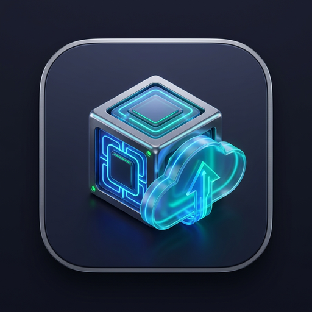
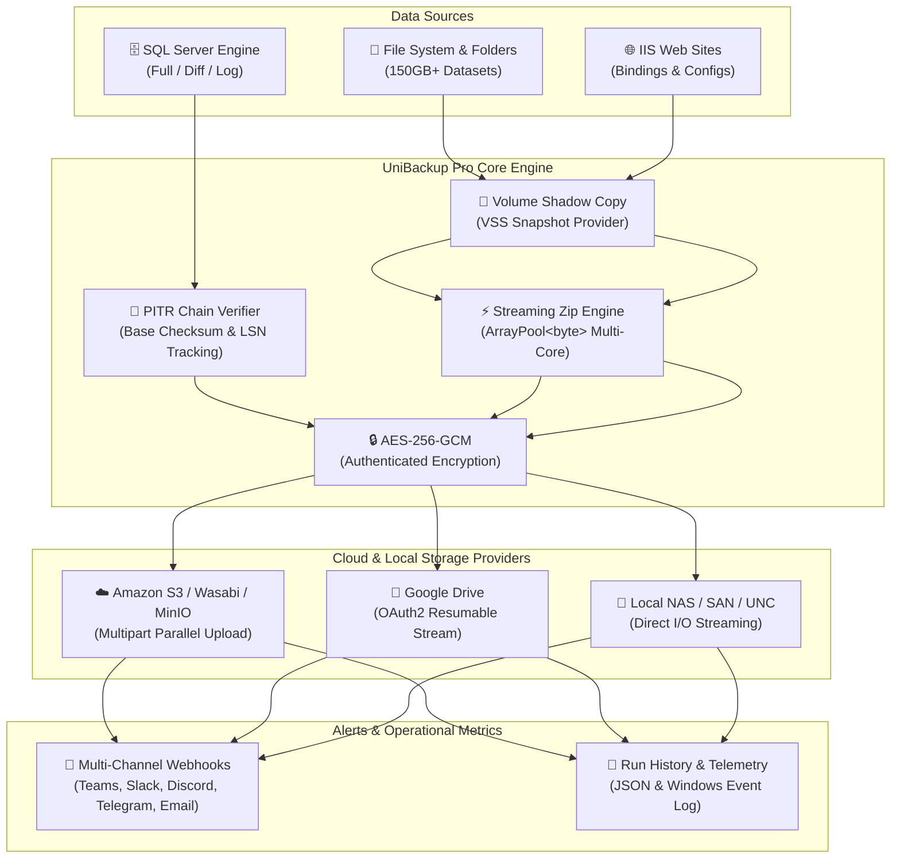
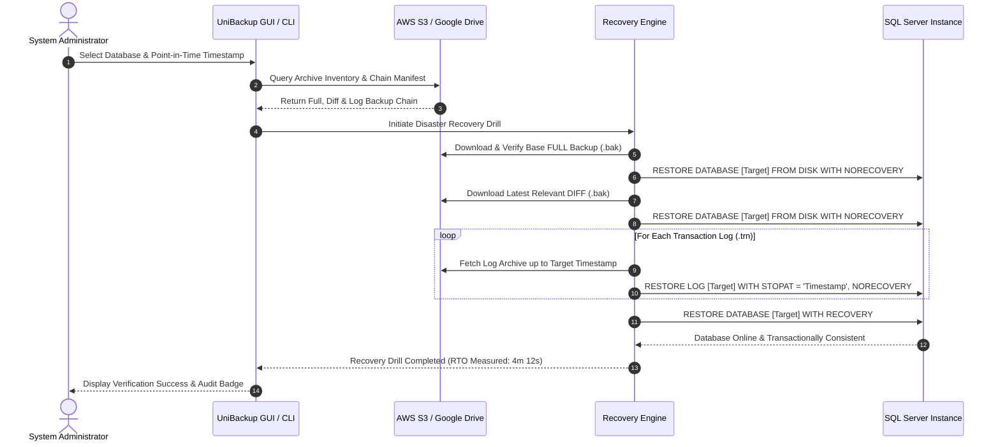

<div align="center">



# 🛡️ UniBackup Pro
### *Universal Cloud Backup & Disaster Recovery Platform for Windows*

[](https://microsoft.com/windows)
[-512BD4?style=for-the-badge&logo=dotnet&logoColor=white)](https://dotnet.microsoft.com)
[](https://github.com/lepoco/wpfui)
[](#-enterprise-cryptography--security-model)
[-2ea44f?style=for-the-badge&logo=githubactions&logoColor=white)](#-testing-verification--quality-assurance)
[](./LICENSE)

<p align="center">
  <b>A unified, resilient, zero-dependency backup engine combining SQL Server Point-In-Time Recovery (PITR), live IIS site packaging, and filesystem streaming with multi-cloud replication.</b>
</p>

[Key Features](#-key-features--capabilities) •
[Architecture](#-system-architecture) •
[SQL PITR](#-sql-server-disaster-recovery) •
[Execution Modes](#-execution-modes) •
[CLI Reference](#-headless-cli-command-reference) •
[PowerShell Module](#-powershell-automation-module) •
[Quickstart](#-quickstart--installation)

---

</div>

## 🌟 Overview

**UniBackup Pro** is an enterprise-grade backup automation and disaster recovery suite designed natively for **Windows Server** and **Windows 10/11**. Engineered in **.NET 9 (C# 13)**, it unites mission-critical SQL Server backup chains, live IIS web server packaging, and multi-terabyte filesystem compression into a single lightweight, self-contained executable.

Whether safeguarding multi-database SQL Server clusters with point-in-time recovery, replicating assets to **Amazon S3** and **Google Drive**, or orchestrating automated restore drills, UniBackup Pro guarantees data durability with zero licensing fees.

---

## ⚡ Key Features & Capabilities

* **🗄️ SQL Server Full, Differential & Log Chains**
  * Automated discovery of SQL instances (Local, Named Instances, Express, and Enterprise).
  * Point-in-time recovery with log sequence chain tracking and automatic base repairs.
  * Native SQL Server streaming compression, checksumming, and `RESTORE VERIFYONLY` validation before offsite dispatch.

* **📂 Multi-Core Parallel Zip Streaming**
  * High-performance archiving engine backed by pooled memory buffers (`ArrayPool<byte>`).
  * Seamlessly processes folders exceeding **150 GB+** without exhausting RAM or choking disk I/O.

* **📸 Volume Shadow Copy Service (VSS)**
  * Instant point-in-time filesystem snapshots eliminate file-lock exceptions across active web servers, database files, and system registries.

* **🌐 Native IIS Web Farm Packaging**
  * Direct integration with `Microsoft.Web.Administration`.
  * Automatically scans hosted websites, virtual directories, binding pools, and extracts `web.config` environments on the fly.

* **☁️ Multi-Cloud Destination Replication**
  * Parallel dual-target uploads to **Amazon S3** (including S3-compatible endpoints like Wasabi, MinIO, and Backblaze B2) and **Google Drive** (via OAuth2 desktop credentials).
  * Local NAS and UNC network share replication with auto-healing retry pipelines.

* **🔒 Defense-in-Depth Cryptography**
  * **AES-256-GCM** authenticated archive encryption with PBKDF2 key derivation.
  * **Windows DPAPI** (`ProtectedData`) master key isolation for cloud tokens, connection strings, and webhook secrets.

* **🔔 Multi-Channel Incident Alerting**
  * Instant notifications dispatch to **Slack**, **Microsoft Teams**, **Discord**, **Telegram**, **Pushover**, **ntfy**, **PagerDuty**, custom REST webhooks, and **SMTP MailKit**.

* **💻 Headless Automation & Native PowerShell Support**
  * Flexible execution models: Continuous Windows Service daemon, scheduled task trigger, or reactive CLI.
  * Comprehensive PowerShell module (`UniBackup.psm1`) with native object pipeline integration.

---

## 📊 Comparison Matrix

| Feature | Legacy Python Scripts | Commercial SQL Tools ($499+) | UniBackup Pro (.NET 9) |
|---|---|---|---|
| **Licensing** | Open-source | Expensive per-server license | **100% Free & Open-Source (MIT)** |
| **SQL Server Support** | None / Scripted `sqlcmd` | Full/Diff/Log (Proprietary format) | **Full / Diff / Log with Native PITR Chains** |
| **VSS Locked Files** | Crashes on open files | Supported | **Native Volume Shadow Copy (VSS)** |
| **IIS Integration** | Shell-parsed `appcmd.exe` | Manual file backups | **Native `Microsoft.Web.Administration`** |
| **Compression** | Single-threaded GIL zip | Proprietary zip | **Multi-Core Pooled `ArrayPool<byte>` Streaming** |
| **Resilience & Retries** | Basic retry loop | Static retry count | **Polly v8 Exponential Backoff with Jitter** |
| **Credential Security** | Plaintext / Static 3DES | Proprietary / Registry | **AES-256-GCM + Windows DPAPI Isolation** |
| **Modern Desktop UI** | Tkinter / Legacy WinForms | Heavy WinForms (Old look) | **WPF Fluent Design (Dark & Light Glass)** |
| **Deployment** | Python runtime + pip wheels | Multi-part MSI installer | **Self-Contained Single Native Executable** |

---

## 🏛️ System Architecture

UniBackup Pro is designed as a modular pipeline where data acquisition, compression, encryption, cloud replication, and notifications operate as decoupled, testable services.



---

## 🗄️ SQL Server Disaster Recovery

UniBackup Pro provides end-to-end database recovery workflows, preventing corrupted or incomplete restore chains from ever reaching production.



### Chain Preservation Rules
1. **Unbroken Base Guarantee**: If a Differential or Transaction Log backup is requested, but the corresponding Base Full backup is missing or failed to replicate to any target, the engine automatically escalates the run to a **Full Backup**.
2. **Simple Recovery Guard**: Databases in `SIMPLE` recovery mode automatically skip transaction log runs with a clean diagnostic warning rather than generating an error.
3. **Pre-flight Integrity Check**: Every database archive is verified via native `RESTORE VERIFYONLY` against the SQL engine prior to cloud transmission.

---

## 🖥️ Modern Fluent UI Experience

Built with WPF and styled under the **Fluent Design System**, UniBackup Pro provides an intuitive, telemetry-driven operations cockpit:

* **Dark & Light Obsidian Glass**: Seamless theme switching with high-contrast accessibility compliance.
* **Real-time Live Progress Rings**: Dynamic SVG-like circular gauges displaying transfer throughput and completion percentages.
* **Unified Application Logs**: Color-coded diagnostic logs with interactive substring filtering, error counters, and one-click log directory access.
* **Multi-Channel Notification Center**: Visual test messengers for verifying Slack, Microsoft Teams, Discord, Telegram, and SMTP credentials.
* **Integrated Job Wizard**: 4-step wizard guiding administrators through folder selection, SQL connection tuning, scheduling rules, and encryption passphrases.

---

## 🚀 Quickstart & Installation

### Option 1: Portable Standalone Executable (Recommended)
Download the latest single-file binary from [Releases](https://github.com/your-org/unibackup/releases):

```powershell
# Extract and launch the interactive desktop interface
.\UniBackup.exe
```

### Option 2: Build from Source (.NET 9 SDK required)
```powershell
# Clone the repository
git clone https://github.com/your-org/unibackup.git
cd unibackup

# Run automated unit test suite (135 tests)
dotnet test "UniBackup Pro/UniBackup.slnx"

# Build self-contained release executable
cd "UniBackup Pro"
.\publish_release.bat
```

The compiled release binary is output to: `dist/UniBackup_Release/UniBackup.exe`

---

## ⚙️ Execution Modes

UniBackup Pro supports three distinct execution models to suit any infrastructure footprint:

```
┌────────────────────────────────────────────────────────────────────────┐
│                        CHOOSE YOUR EXECUTION MODEL                     │
│                                                                        │
│  [OPTION A]  Windows Background Service (Recommended for Production)   │
│  • Runs continuously in the background under NT AUTHORITY\SYSTEM.      │
│  • Self-healing: automatically restarts upon system reboot or failure. │
│  • Zero human interaction required.                                    │
│                                                                        │
│  [OPTION B]  Windows Task Scheduler (Recommended for Low-Memory VMs)   │
│  • Zero memory footprint when idle (process runs only when due).       │
│  • Triggered via native Task Scheduler: UniBackup.exe --auto           │
│                                                                        │
│  [OPTION C]  Interactive Desktop UI & System Tray                      │
│  • Live dashboard, interactive wizards, and 1-click cloud recovery.    │
│  • Ideal for workstations, initial configuration, and manual runs.    │
└────────────────────────────────────────────────────────────────────────┘
```

---

## ⌨️ Headless CLI Command Reference

`UniBackup.exe` switches to headless command-line mode automatically whenever arguments are supplied:

```powershell
# Run all enabled backup jobs sequentially
UniBackup.exe --auto

# Execute a specific backup job by ID
UniBackup.exe --auto --job sql-production

# Execute a SQL job specifying backup chain tier (Full / Diff / Log)
UniBackup.exe --auto --job sql-production --type Log

# Run full server diagnostics & cloud connection tests
UniBackup.exe --validate

# List all configured jobs, schedules, and targets in tabular format
UniBackup.exe --list-jobs

# Output job list formatted as JSON (for scripting/monitoring)
UniBackup.exe --list-jobs --json

# Display recent execution history
UniBackup.exe --history --limit 20
```

### Windows Service Management CLI
```powershell
# Check current service state (Running / Stopped / Not Installed)
UniBackup.exe --service status

# Install as Windows Background Service (elevated prompt required)
UniBackup.exe --service install

# Start or stop the service
UniBackup.exe --service start
UniBackup.exe --service stop

# Uninstall the service
UniBackup.exe --service uninstall
```

### CLI Exit Codes
| Code | Status | Meaning |
|:---:|---|---|
| `0` | **Success** | All operations, backups, and validations completed without error. |
| `1` | **Failure** | One or more critical jobs failed, missing source paths, or invalid credentials. |
| `2` | **Partial** | Partial success (e.g., S3 upload succeeded, but secondary cloud target timed out). |

---

## 💻 PowerShell Automation Module

UniBackup Pro includes a native PowerShell module located at `modules/UniBackup/UniBackup.psd1`. It provides pipeline-aware cmdlets for enterprise sysadmin scripting.

### Importing the Module
```powershell
Import-Module ".\UniBackup Pro\modules\UniBackup\UniBackup.psd1"
```

### Available Cmdlets & Examples
```powershell
# 1. Retrieve all configured jobs as PowerShell objects
$jobs = Get-UBJob
$jobs | Format-Table Id, Name, Schedule, Destinations

# 2. Trigger a backup job and await completion
$result = Start-UBJob -Id "sql-production" -Type "Full" -Wait
if ($result.Success) {
    Write-Host "Backup completed successfully! Bytes: $($result.BytesUploaded)" -ForegroundColor Green
}

# 3. Inspect recent backup history
Get-UBHistory -JobId "sql-production" -Limit 10 | Select-Object Timestamp, Outcome, Duration, ArchiveName

# 4. Export encrypted server configuration for disaster recovery
Export-UBConfig -Path "C:\Vault\server_backup.ubcfg" -Passphrase "MasterSecretKey!2026"

# 5. Restore configuration to a newly provisioned server
Import-UBConfig -Path "C:\Vault\server_backup.ubcfg" -Passphrase "MasterSecretKey!2026"
```

---

## 🔔 Alerts & Notification Dispatch

UniBackup Pro features a unified notification dispatcher that broadcasts structured alerts upon job start, success, warning, or catastrophic failure:

* **Email (SMTP)**: Direct TLS/SSL support via MailKit with recipient distribution lists.
* **Chat Webhooks**: Pre-formatted, branded alert cards with status badges and error traces:
  * **Microsoft Teams** (MessageCard & Adaptive Card)
  * **Slack** (Blocks API)
  * **Discord** (Embed API)
  * **Telegram Bot** (Markdownv2 Message API)
* **Incident Management**:
  * **PagerDuty** (Events API v2 trigger)
  * **Pushover** (High-priority push notifications)
  * **ntfy** (Self-hosted or cloud push pub-sub)
  * **Custom REST Webhook**: POST arbitrary JSON payloads to your custom API endpoint.

---

## 🔒 Enterprise Cryptography & Security Model

```
┌────────────────────────────────────────────────────────────────────────┐
│                        UNIBACKUP DEFENSE-IN-DEPTH                      │
│                                                                        │
│  [At Rest]     AES-256-GCM Authenticated Encryption                    │
│                • 256-bit symmetric key derived via PBKDF2 (100k rounds)│
│                • 96-bit unique IV per archive                          │
│                • 128-bit authentication tag prevents tampering        │
│                                                                        │
│  [In Memory]   Windows DPAPI (Data Protection API)                     │
│                • Cloud secret keys, tokens & connection strings sealed │
│                • ProtectedDataScope.LocalMachine (Service execution)   │
│                • ProtectedDataScope.CurrentUser (Desktop UI execution) │
│                                                                        │
│  [In Transit]  TLS 1.3 / Enforced HTTPS                                │
│                • AWS S3 & Google Drive REST operations enforce TLS 1.3 │
│                • SQL Server TDS channel validation                     │
└────────────────────────────────────────────────────────────────────────┘
```

---

## 🧪 Testing, Verification & Quality Assurance

The solution is backed by an automated test suite verifying cryptographic integrity, compression streaming, serialization contracts, and SQL Server recovery chains:

```powershell
# Run the complete test suite
dotnet test "UniBackup Pro/UniBackup.slnx"
```

```
Passed!  - Failed:     0, Passed:   135, Skipped:     7, Total:   142
Duration: 8.4s - UniBackup.Tests.dll (net9.0)
```

* **135 Automated Unit & Integration Tests**:
  * `CredentialProtectorTests`: Validates AES-256-GCM sealing, DPAPI machine isolation, and legacy 3DES unsealing.
  * `HighSpeedZipArchiveServiceTests`: Validates parallel streaming compression, empty folders, and directory hierarchy retention.
  * `SqlBackupChainTests`: Validates Base-Differential-Log sequence validation and auto-healing rules.
  * `NotificationPayloadTests`: Validates webhook JSON formats across Teams, Slack, and Discord.

---

## 📁 Repository Structure

```
Universal Backup Tool/
├── UniBackup Pro/                      # ★ Primary Production Solution
│   ├── src/
│   │   ├── UniBackup.Core/             # Domain entities, interfaces & models
│   │   ├── UniBackup.Infrastructure/   # Cloud SDKs, VSS, SQL Server, Crypto, MailKit
│   │   ├── UniBackup.Engine/           # Backup execution pipeline & recovery drills
│   │   ├── UniBackup.Service/          # Background Windows Service host
│   │   ├── UniBackup.Cli/              # Standalone CLI entrypoint
│   │   └── UniBackup.UI/               # WPF Fluent UI (Publishes single UniBackup.exe)
│   ├── tests/
│   │   └── UniBackup.Tests/            # Automated xUnit test suite (135 tests)
│   ├── modules/
│   │   └── UniBackup/                  # PowerShell module (UniBackup.psd1 / .psm1)
│   ├── docs/                           # Architecture guides & UI design specs
│   ├── publish_release.bat             # Release publishing script
│   └── UniBackup.slnx                  # Solution file
│
├── dist/                               # Shipped single-file binaries
│   └── UniBackup.exe                   # Production executable (~88 MB)
├── UniBackup.png                       # High-resolution brand emblem
├── .gitignore                          # Enterprise .NET 9 ignore rules
└── README.md                           # Master documentation
```

---

## 📄 License & Credits

UniBackup Pro is open-source software licensed under the **[MIT License](./LICENSE)**.

Designed and engineered with passion for high reliability, zero-compromise security, and rock-solid disaster recovery. Built with **.NET 9**, **C# 13**, and **WPF Fluent UI**.
